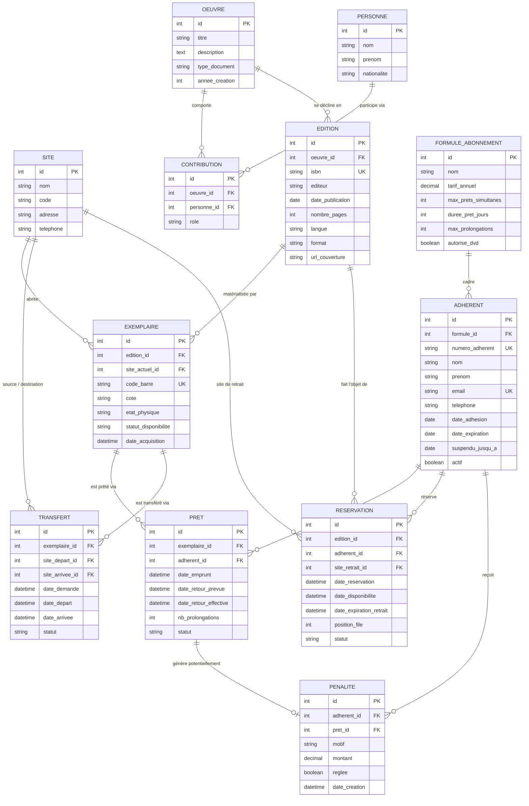

# Modèle de Données — Réseau de Médiathèques

Ce document décrit la structure de la base de données et la modélisation conceptuelle du domaine pour le projet de gestion de réseau de médiathèques (Symfony 7.4 / MySQL 8).

---

## 1. Vue d'ensemble de l'architecture métier

La modélisation s'appuie sur le standard bibliothéconomique **FRBR (Functional Requirements for Bibliographic Records)** adapté aux contraintes opérationnelles d'un réseau multi-sites :

1. **Œuvre** : L'abstraction intellectuelle (ex. *Le Petit Prince* d'Antoine de Saint-Exupéry).
2. **Édition** : La manifestation concrète / publication commerciale (ex. Folio Junior 2015, format poche, ISBN distinct).
3. **Exemplaire** : L'objet physique inventorié avec un code-barres / une cote, localisé dans l'un des deux sites physiques, disposant d'un état d'usure et d'un cycle de disponibilité.
4. **Circulation & Usagers** : Gestion des adhérents, abonnements, prêts, réservations en file d'attente, transferts inter-sites et pénalités.

---

## 2. Diagramme des Entités (ERD)

---

## 3. Détail des Entités et Choix de Conception

### 3.1 Catalogue et Bibliographie

#### `Oeuvre`
- **Rôle** : Regroupe l'essence intellectuelle d'une création artistique ou littéraire.
- **Attributs clés** :
  - `titre` : Titre original ou d'usage général.
  - `type_document` : Énumération (`LIVRE`, `BD`, `DVD`, `REVUE`).
  - `description` : Résumé général de l'œuvre.
  - `annee_creation` : Année d'écriture ou de parution originelle.

#### `Personne` & `Contribution` (Auteurs, Traducteurs, Illustrateurs)
- **Choix de modélisation** : Une table associative `Contribution` relie `Personne` à `Oeuvre` avec une colonne `role`.
- **Rôles supportés** : `AUTEUR`, `SCENARISTE`, `DESSINATEUR`, `COLORISTE`, `TRADUCTEUR`, `REALISATEUR`, `ACTEUR`.
- **Justification** : Permet de gérer sans redondance les œuvres collaboratives (ex: scénariste + illustrateur d'une BD, réalisateur d'un film, traducteur d'un roman).

#### `Edition`
- **Rôle** : Représente une déclinaison éditoriale commerciale précise d'une œuvre.
- **Attributs clés** :
  - `isbn` : Identifiant international unique (indexé, nullable pour les DVD sans ISBN qui ont un code EAN/UPC).
  - `editeur`, `date_publication`, `nombre_pages`, `langue`, `format`, `url_couverture`.
- **Lien Open Library** : Les fiches importées via Open Library correspondent exactement à cette entité `Edition`.

#### `Exemplaire`
- **Rôle** : L'unité physique empruntable détenue par le réseau.
- **Attributs clés** :
  - `code_barre` : Identifiant unique scanné lors des prêts/retours.
  - `cote` : Localisation thématique en rayon (ex: `R HUG 843`).
  - `site_actuel` : Référence vers le `Site` où se trouve physiquement l'exemplaire.
  - `etat_physique` : `NEUF`, `TRES_BON`, `BON`, `ABIME`, `PERDU`.
  - `statut_disponibilite` : `DISPONIBLE`, `EMPRUNTE`, `RESERVE`, `EN_TRANSIT`, `INDISPONIBLE`.

---

### 3.2 Lieux et Logistique

#### `Site`
- Représente les deux médiathèques physiques du réseau.
- Permet de rattacher les exemplaires, de gérer les transferts et d'orienter les retraits de réservations.

#### `Transfert`
- Gère la circulation des documents d'un site à l'autre (navette).
- Statuts : `DEMANDE`, `EN_TRANSIT`, `RECU`, `ANNULE`.

---

### 3.3 Adhérents et Abonnements

#### `FormuleAbonnement`
- Définit les droits et quotas associés à un profil d'usager.
- Exemples :
  - **Jeunesse** : Gratuit, 5 livres/BDs max, 21 jours, pas de DVD.
  - **Classique** : 15 €/an, 8 documents, 28 jours, 2 prolongations.
  - **Passion / Multimédia** : 25 €/an, 12 documents dont 4 DVD, 28 jours.

#### `Adherent`
- Représente l'usager du réseau.
- Attributs de contrôle :
  - `numero_adherent` : Identifiant unique pour la carte d'adhérent.
  - `date_expiration` : Fin de validité de la cotisation annuelle.
  - `suspendu_jusqu_a` : Bloque tout nouvel emprunt en cas de pénalité ou retard non régularisé.

---

### 3.4 Cycle de Vie des Prêts, Réservations et Pénalités

#### `Pret`
- Enregistre chaque emprunt d'un `Exemplaire` par un `Adherent`.
- `statut` : `EN_COURS`, `RENDU`, `EN_RETARD`, `PERDU`.
- `nb_prolongations` : Incrémenté à chaque demande (bloqué si limite atteinte ou si l'édition est réservée).

#### `Reservation`
- Implémente la file d'attente sur une `Edition`.
- `position_file` : Détermine l'ordre de priorité (FIFO).
- `date_expiration_retrait` : Décompte de 7 jours dès que le document est mis de côté.

#### `Penalite`
- Historise les infractions (retards récurrents, perte, détérioration) et leur régularisation financière ou administrative.

---

## 4. Contraintes d'Intégrité et Index MySQL 8

1. **Unicité** :
   - `adherent.numero_adherent` (UNIQUE)
   - `adherent.email` (UNIQUE)
   - `edition.isbn` (UNIQUE conditionnel / indexé)
   - `exemplaire.code_barre` (UNIQUE)
   - `site.code` (UNIQUE)
2. **Indexation de performance** :
   - Index sur `exemplaire.statut_disponibilite` et `exemplaire.site_actuel_id` (recherche rapide d'exemplaires disponibles par site).
   - Index sur `pret.statut` et `pret.date_retour_prevue` (détection efficace des retards par commande planifiée).
   - Index composite sur `reservation (edition_id, statut, position_file)` pour le dépilage rapide de la file d'attente.
