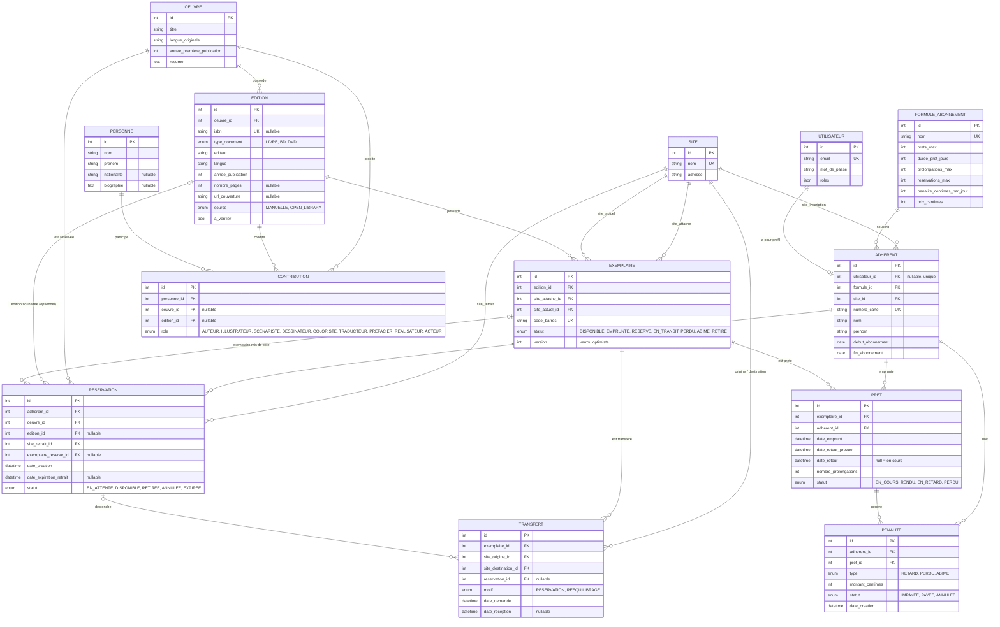

# Modèle de données — Réseau de médiathèques

**Projet** : PFE Challenge EMC, Sujet 4
**Auteur** : Amine Nekhla
**Date** : 11 novembre 2026

Ce document est la référence pour les entités Doctrine. Les noms (entités, statuts, rôles) sont identiques à ceux de `docs/DECISIONS.md`.

## 1. Diagramme



## 2. Les choix de conception

### 2.1 Œuvre → Édition → Exemplaire (inspiré de FRBR)
- `Oeuvre` : le contenu intellectuel (*1984*).
- `Edition` : une publication précise (ISBN, éditeur, langue, type de document).
- `Exemplaire` : l'objet physique avec un code-barres, c'est lui qui est prêté.
- Les statistiques (documents les plus empruntés) peuvent se faire par exemplaire, par édition ou par œuvre.

### 2.2 Personne + Contribution (auteurs multiples, traducteurs, illustrateurs)
- Une `Contribution` relie une `Personne` à **soit** une `Oeuvre`, **soit** une `Edition`, avec un `role`.
- Règle d'intégrité : **exactement un** des deux champs `oeuvre_id` / `edition_id` est renseigné (validation dans l'entité, contrainte `CHECK` possible en MySQL 8).
- Auteur, scénariste, dessinateur, réalisateur : au niveau de l'**œuvre**. Traducteur, préfacier : au niveau de l'**édition**.

### 2.3 Réservation : œuvre obligatoire, édition optionnelle
- Si `edition_id` est **vide**, l'adhérent accepte le premier exemplaire disponible de n'importe quelle édition de l'œuvre.
- Si `edition_id` est **renseigné**, seuls les exemplaires de cette édition conviennent.
- La file d'attente est ordonnée par `date_creation` : le premier réservant est servi au retour du document.

### 2.4 Deux sites sur l'exemplaire + Transfert
- `site_attache` : où l'exemplaire est rattaché. `site_actuel` : où il se trouve physiquement.
- Un `Transfert` est créé quand un exemplaire doit changer de site (réservation sur l'autre site, rééquilibrage). Pendant le trajet, l'exemplaire est `EN_TRANSIT`.

### 2.5 Cycle de vie de la réservation

```
EN_ATTENTE → DISPONIBLE → RETIREE
     │            │
     └→ ANNULEE   └→ EXPIREE (7 jours ouvrés dépassés)
```

- Au retour d'un exemplaire (ou à l'arrivée d'un transfert), le premier de la file passe à `DISPONIBLE` et `date_expiration_retrait = maintenant + 7 jours ouvrés`.
- À l'expiration : la réservation passe à `EXPIREE`, le suivant dans la file est servi, sinon l'exemplaire redevient `DISPONIBLE`.

### 2.6 Montants en centimes (entiers)
Pas de décimaux pour l'argent : les flottants provoquent des erreurs d'arrondi (0,1 + 0,2 ≠ 0,3). Monnaie : MAD.

### 2.7 Utilisateur séparé d'Adhérent
Le personnel (bibliothécaire, administrateur) a un compte `Utilisateur` mais pas de fiche `Adherent`. `utilisateur_id` est donc nullable sur l'adhérent. Rôles : `ROLE_ADHERENT`, `ROLE_BIBLIOTHECAIRE`, `ROLE_ADMIN`.

### 2.8 Concurrence (deux opérations en même temps sur un exemplaire)
- **Verrou pessimiste** (`SELECT ... FOR UPDATE`) sur l'exemplaire dans une transaction pour tout prêt, retour ou mise de côté.
- **Verrou optimiste** : la colonne `version` de l'exemplaire détecte les modifications concurrentes.
- Un exemplaire ne peut avoir qu'un seul prêt `EN_COURS` à la fois : vérifié dans `PretService` sous verrou, et testé automatiquement.

## 3. Règles métier portées par le modèle

| Règle | Où elle vit |
|---|---|
| Nombre de prêts simultanés et durée | `FormuleAbonnement.prets_max` / `duree_pret_jours` |
| Prolongation seulement si personne n'attend | `PretService`, en regardant les `Reservation` `EN_ATTENTE` de l'œuvre |
| Nombre maximal de prolongations | `Pret.nombre_prolongations` ≤ `FormuleAbonnement.prolongations_max` |
| Pénalité de retard | `Penalite` (type `RETARD`) = jours de retard × `penalite_centimes_par_jour` |
| Exemplaire perdu ou abîmé | `Exemplaire.statut` + `Penalite` (type `PERDU` ou `ABIME`) |
| Adhérent bloqué si abonnement expiré ou pénalités impayées | `PretService` |

## 4. Limites connues (v1)

- L'envoi d'e-mail de notification dépend de la configuration de Symfony Mailer (voir `DECISIONS.md`) ; à défaut, notification dans l'espace adhérent.
- Pas de gestion des jours fériés pour le calcul des « jours ouvrés » : on exclut seulement samedi et dimanche.
- Pas de paiement en ligne des pénalités : le bibliothécaire enregistre le paiement.